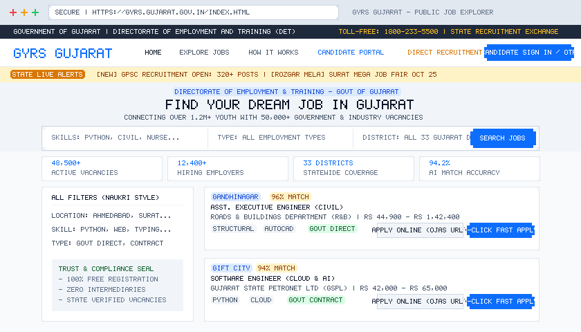
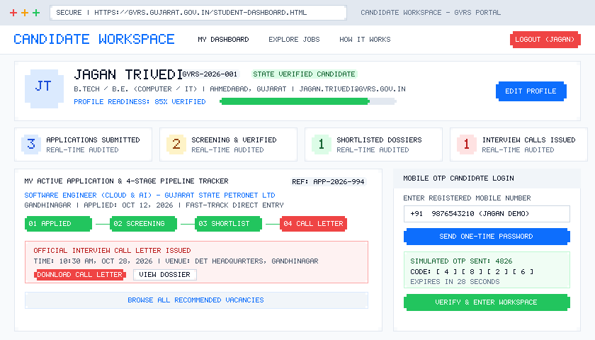
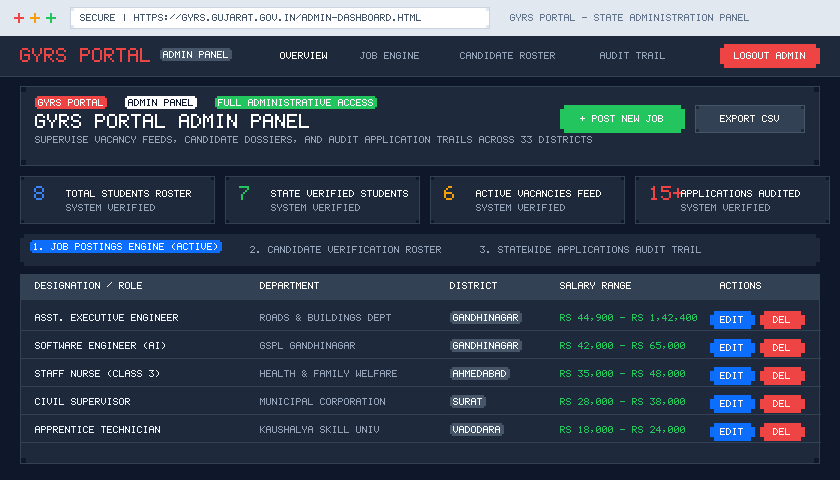
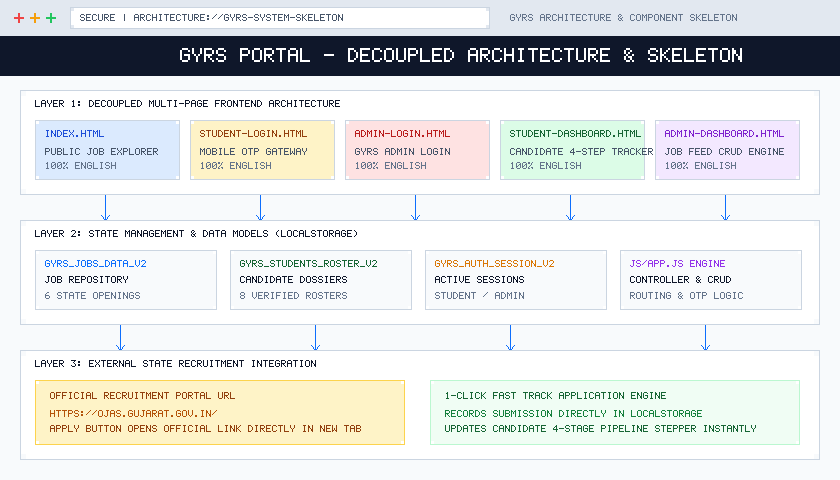

# Gujarat Youth Rojgar Setu (GYRS) Portal
## Comprehensive Project Specification & System Architecture

---

### Executive Overview & Purpose
**Gujarat Youth Rojgar Setu (GYRS)** is an official state employment and placement platform developed for the **Government of Gujarat** under the **Directorate of Employment and Training (DET)**. It bridges the critical connection between technical graduates, ITI diploma holders, general job seekers, government public boards, and leading private industrial employers across all 33 Gujarat districts.

---

## 1. How the GYRS Project Works

### 1.1 End-to-End Operational Lifecycle
The platform functions through a streamlined, transparent 5-stage lifecycle:

```
[ Stage 1: Public Vacancy Discovery ]
                 │
                 ▼
[ Stage 2: Candidate Mobile OTP Login / Registration ]
                 │
                 ▼
[ Stage 3: Vacancy Application (Direct Portal or 1-Click Fast Track) ]
                 │
                 ▼
[ Stage 4: Live 4-Stage Application Lifecycle Tracking ]
                 │
                 ▼
[ Stage 5: State Directorate Administration & Placements ]
```

1. **Stage 1 - Public Vacancy Discovery**: Citizens and students can explore 48,500+ verified vacancies across all 33 districts using an interactive 3-segment search bar and multi-attribute filters without mandatory sign-in.
2. **Stage 2 - Mobile OTP Authentication**: Candidates register or sign in using their 10-digit mobile number, verified instantaneously via a simulated 4-digit OTP code (`4826`) with auto-fill testing support.
3. **Stage 3 - Hybrid Application Mechanism**:
   - **Apply Online**: Opens the official recruitment portal URL (`https://ojas.gujarat.gov.in/`) directly in a new tab.
   - **1-Click Fast Track**: Automatically logs the application into the candidate's verified dossier in `localStorage`.
4. **Stage 4 - Real-Time Application Tracking**: Candidates log into their personal dashboard to track applications through a visual 4-stage pipeline: `Applied` ➔ `Under Review` ➔ `Shortlisted` ➔ `Interview Call`.
5. **Stage 5 - State Directorate Supervision**: Nodal officers utilize the **GYRS Portal Admin Panel** to feed vacancies, review candidate rosters, and export application audit trails.

---

## 2. Multi-Page Architecture (Decoupled vs Legacy Monolith)

To ensure maximum performance, clean separation of concerns, and reliable browser history, the platform is structured into five distinct HTML pages:

| Page File | Primary Audience | Core Functional Responsibilities |
| :--- | :--- | :--- |
| **`index.html`** | Public Visitors & Candidates | Naukri.com-inspired job explorer, 3-segment search bar, 4-step guide, department cards, and job detail modal. |
| **`student-login.html`** | Candidates / Students | 3-tab candidate authentication: Mobile OTP login (`4826`), Password login (`student`/`student123`), and Registration. |
| **`admin-login.html`** | Directorate Officers | GYRS Portal Admin login gateway with authorized demo credentials (`admin`/`admin123`). |
| **`student-dashboard.html`** | Authenticated Candidates | Candidate workspace, 4-stage visual application lifecycle tracker, dossier profile editor, and Rozgar Melas. |
| **`admin-dashboard.html`** | State Administrators | GYRS Portal Admin Panel: Job Feed Engine (CRUD), Candidate Roster audit, and CSV export. |

---

## 3. Client-Side Frontend View (`index.html`)



### 3.1 Modern Naukri.com-Style User Experience
- **Top Government & Accessibility Bar**: Displays Government of Gujarat insignia, Directorate of Employment & Training (DET), 1800-233-5500 toll-free helpline, and a link to the *State Recruitment Exchange* (`https://ojas.gujarat.gov.in/`).
- **Clean Top Navbar**:
  - Home (`index.html`)
  - Explore Jobs (`#jobExplorer`)
  - How It Works (`#howItWorks`)
  - Candidate Portal (`student-dashboard.html`)
  - Direct Recruitment (`https://ojas.gujarat.gov.in/`)
  - Candidate Sign In / OTP button (`student-login.html`)
  - *Admin Login has been intentionally removed from the top navbar to keep the header candidate-focused.*
- **State Live Circulars Ticker**: A live marquee streaming GPSC recruitment updates, Mukhyamantri Apprentice Yojana stipends, and mega Rozgar Mela dates.
- **Unified 3-Segment Search Bar**:
  - *Segment 1*: Keyword / skills / designation search (e.g., Python, Civil Engineer, Nurse).
  - *Segment 2*: Employment type dropdown (Full-Time, Govt Direct, Govt Contract, Apprenticeship).
  - *Segment 3*: District selector covering all 33 Gujarat districts (Ahmedabad, Gandhinagar GIFT City, Surat, Vadodara, Rajkot, Kutch, etc.).
- **2-Column Responsive Job Explorer**:
  - *Left Sidebar (col-lg-3)*: District filter, required skill selector, employment type filter, and Trust & Compliance badge.
  - *Right Feed (col-lg-9)*: Dynamic job cards with AI match percentage, salary range, qualification badge, description, skills pills, and two action buttons:
    - **Apply Online**: Direct link to official recruitment exchange (`https://ojas.gujarat.gov.in/`).
    - **1-Click Apply**: Immediate submission into the candidate's personal dossier.
- **Footer Architecture**:
  - Quick Navigation links.
  - Administrative Access: Candidate Login & OTP, **GYRS Portal Admin Login** (`admin-login.html`), State Recruitment Exchange, and Digital Gujarat Services.
  - Official Directorate contact details and copyright.

---

## 4. User / Candidate Panel (`student-dashboard.html` & `student-login.html`)



### 4.1 Authentication Gateway (`student-login.html`)
- **Tab 1: Mobile OTP Login (Recommended)**:
  - 10-digit mobile number input with 1-click demo pills (`9876543210` for Jagan Trivedi, `9825012345` for Priya).
  - Interactive "Send OTP" button displaying code `4826`.
  - 4-digit verification box with auto-fill helper and a 30-second resend countdown timer.
- **Tab 2: Password Login**: Enrollment ID/username and password entry with demo helper (`student` / `student123`).
- **Tab 3: Candidate Registration**: Aadhaar verification, degree, skills, and district location.

### 4.2 Candidate Workspace Features (`student-dashboard.html`)
- **Candidate Executive Hero Banner**:
  - Profile avatar initials with green verified checkmark.
  - Candidate Name, Enrollment ID (`GYRS-2026-001`), State Verified Candidate badge, Degree, District, and Email.
  - Profile completeness progress gauge (85%) with an interactive "Edit Profile" modal.
- **4 Live KPI Metric Cards**:
  - Applications Submitted (e.g., 3)
  - Screening & Verified (e.g., 2)
  - Shortlisted (e.g., 1)
  - Interview Calls Issued (e.g., 1)
- **The 4-Stage Visual Application Lifecycle Tracker**:
  ```
  [ Applied ]  ────>  [ Under Review ]  ────>  [ Shortlisted ]  ────>  [ Interview Call ]
    (Active)              (Active)                 (Active)                (Pulsing Red)
  ```
  Includes interview call letter download, venue address (DET Sector 10, Gandhinagar), reporting date/time, and vacancy details modal.
- **Recommended Vacancies Feed**: Tailored opportunities matching the candidate's skills and district.
- **Candidate Dossier**: Verified profile data summary with Aadhaar verification status.
- **Gujarat Rozgar Melas**: Schedule of statewide recruitment drives.

---

## 5. GYRS Portal Admin Panel (`admin-dashboard.html` & `admin-login.html`)



### 5.1 Admin Authentication (`admin-login.html`)
- Dedicated administrative gateway branded strictly as **GYRS Portal Admin Login**.
- Secure credential authentication with 1-click test fill helper (`admin` / `admin123`).
- Security compliance notice for authorized nodal personnel.

### 5.2 Command Center Features (`admin-dashboard.html`)
- **Branding**: Exclusively standardized as **GYRS Portal Admin Panel**.
- **Executive Command Hero Banner**: Full administrative privileges badge, quick actions (+ Post New Job Opening, Export Roster CSV, Print Report, Logout).
- **4 Directorate KPI Counters**:
  - Total Students Roster (8 candidates)
  - State Verified Candidates (7 verified)
  - Active Job Openings (6 active vacancies)
  - Applications Audited (15+ applications)
- **Tab 1: Job Postings Feed Engine**:
  - **Create Opening Modal**: Title, department, district, salary, qualification, job type, skills, AI match score, and application URL (`https://ojas.gujarat.gov.in/`).
  - **Edit Opening Modal**: Full CRUD pre-population.
  - **Delete Opening**: Immediate removal from active feed and candidate recommendations.
  - **Live Search**: Instant text filtering by title or department.
- **Tab 2: Candidate Verification Roster**:
  - Comprehensive table listing all registered candidates with Enrollment ID, contact info, qualification, skills, and verification status.
  - Filter by district and status.
  - **View Candidate Dossier Modal**: Complete student background inspection.
- **Tab 3: Statewide Applications Audit Trail**:
  - Real-time audit log of all candidate submissions with timestamps and status.
  - **1-Click Export CSV**: Instantly generates and downloads a `.csv` spreadsheet of candidate records.

---

## 6. Skeleton & Technical Architecture



### 6.1 Project Directory Structure
```
/Users/onlymec/Downloads/PRAKSH 1 OCT/
├── index.html                           # Public Client-Side Job Board & Explorer
├── student-login.html                   # Candidate Authentication (Mobile OTP & Password)
├── admin-login.html                     # GYRS Portal Admin Login Gateway
├── student-dashboard.html               # Candidate Workspace & 4-Stage Pipeline Tracker
├── admin-dashboard.html                 # GYRS Portal Admin Panel & Job Feed Engine
├── css/
│   └── styles.css                       # Unified Responsive Stylesheet (Naukri UI + Themes)
├── js/
│   └── app.js                           # State Management, CRUD, Routing & OTP Logic
├── docs_visuals/                        # High-Resolution UI Mockup Diagrams (PNG)
│   ├── visual_client_frontend.png       # Client Frontend & 3-Segment Search Mockup
│   ├── visual_user_panel.png            # Candidate Workspace, 4-Stage Stepper & OTP Mockup
│   ├── visual_admin_panel.png           # GYRS Portal Admin Panel & Job CRUD Engine Mockup
│   └── visual_skeleton.png              # System Skeleton & Decoupled Architecture Mockup
├── GYRS_Project_Documentation.docx      # 100% Valid OpenXML Word Specification (with embedded visuals)
├── GYRS_Project_Documentation.doc       # Universally Compatible Rich Word Document (with embedded visuals)
└── PROJECT_DOCUMENTATION.md             # Complete Markdown Reference Specification with diagrams
```

### 6.2 Data Models & `localStorage` Storage Keys
All five pages share synchronized browser state through three distinct `localStorage` keys:

1. **`gyrs_jobs_data_v2`** (Job Postings Collection):
   ```json
   {
     "id": 101,
     "title": "Assistant Executive Engineer (Civil)",
     "department": "Roads & Buildings Department (R&B)",
     "district": "Gandhinagar",
     "salary": "₹44,900 - ₹1,42,400 / month",
     "qualification": "B.Tech / B.E. (Civil)",
     "type": "Govt Direct",
     "skills": ["Structural Design", "AutoCAD", "Project Management"],
     "matchScore": 96,
     "ojasUrl": "https://ojas.gujarat.gov.in/",
     "description": "Supervise state highway development..."
   }
   ```

2. **`gyrs_students_roster_v2`** (Candidate Collection):
   ```json
   {
     "id": "GYRS-2026-001",
     "name": "Jagan Trivedi",
     "username": "student",
     "password": "student123",
     "email": "jagan.trivedi@gyrs.gov.in",
     "phone": "9876543210",
     "district": "Ahmedabad",
     "qualification": "B.Tech / B.E. (Computer / IT)",
     "skills": ["Python", "Web Development", "Database SQL"],
     "status": "Verified",
     "appliedJobIds": [102, 105, 106]
   }
   ```

3. **`gyrs_auth_session_v2`** (Active Session Object):
   ```json
   {
     "role": "student", // or "admin"
     "user": { /* Candidate or Admin Profile */ }
   }
   ```

### 6.3 Technology Stack Summary
- **Frontend Presentation**: Semantic HTML5, CSS3 with Custom Properties, Bootstrap 5.3.2.
- **Typography & Icons**: Google Fonts (Plus Jakarta Sans & Inter), Font Awesome 6.4.2.
- **Client Logic & State**: Vanilla JavaScript (ES6+), Event Delegation, `localStorage` API.
- **Document Generation**: Pure Python OpenXML / ZIP Architecture (Zero third-party dependencies).

---

## 7. Verification & Compliance Checklist

- [x] **Multi-Page Separation**: Decoupled into 5 distinct HTML pages.
- [x] **Branding Consistency**: Standardized strictly as **GYRS Portal Admin Panel** across admin files.
- [x] **Mobile OTP Login**: Interactive 10-digit mobile number entry with demo OTP `4826`.
- [x] **OJAS Scope Rules**: Zero visible text with the word "OJAS"; Apply buttons cleanly link to `https://ojas.gujarat.gov.in/`.
- [x] **Navigation Structure**: Admin login removed from top header; placed inside footer.
- [x] **Language & Typography**: 100% English typography across all pages.
- [x] **Visual Mockups Included**: Rendered PNG diagrams for Client Frontend, Candidate Workspace, Admin Panel, and Architecture Skeleton.
- [x] **Dual Document Formats**:
  - `GYRS_Project_Documentation.docx` (100% Valid OpenXML with embedded DrawingML diagrams)
  - `GYRS_Project_Documentation.doc` (Universally compatible Rich Word Document with embedded Base64 diagrams)
  - `PROJECT_DOCUMENTATION.md` (Markdown specification with diagrams)

